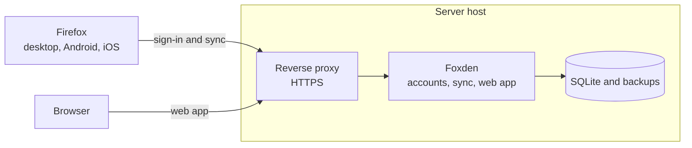
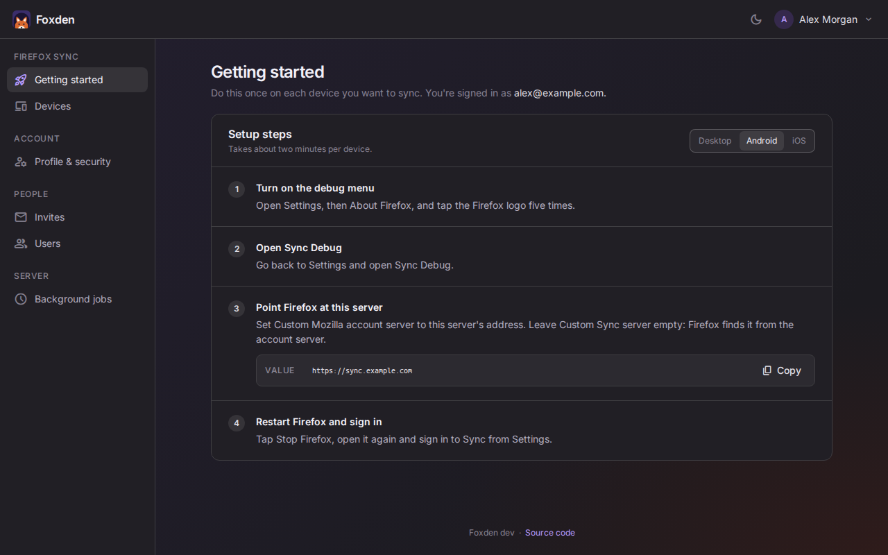
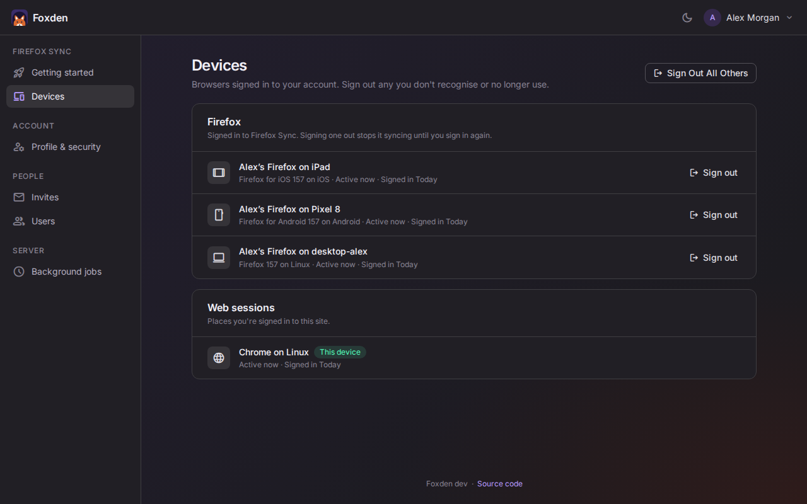
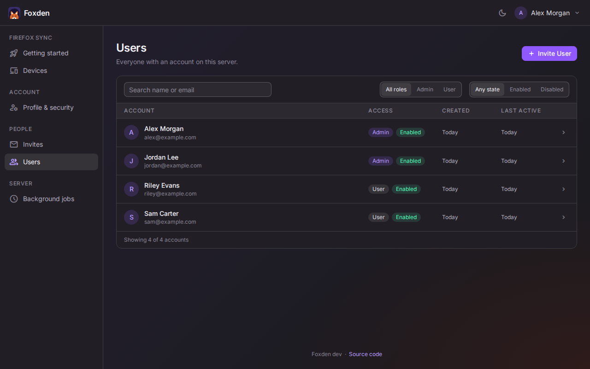
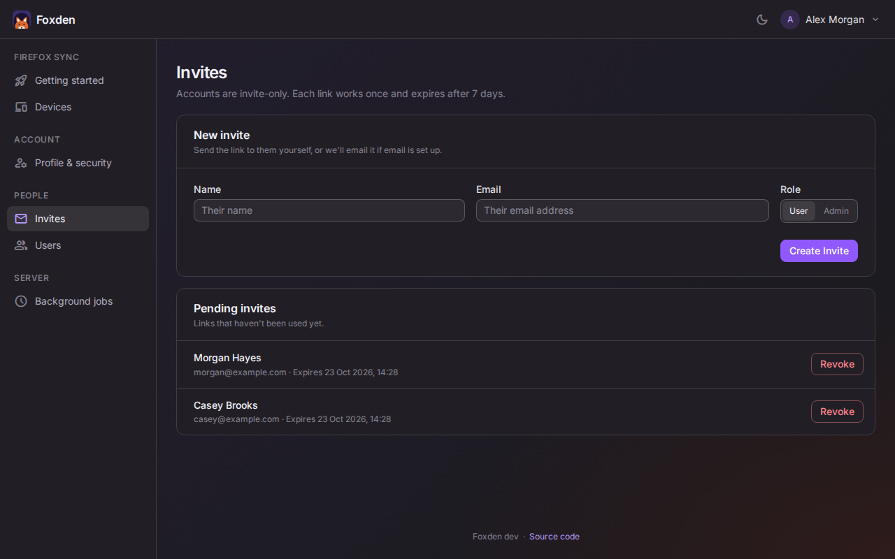

  
  <h1>Foxden</h1>
  <h3>Your own Firefox Sync server</h3>

Foxden is a self-hosted Firefox Sync server for a household or small group. It replaces every Mozilla service that Sync
uses with one Docker container and one SQLite database. Stock Firefox works without add-ons or custom builds.

I built Foxden for privacy, and to own all my data. Your bookmarks, history, passwords and tabs stay on a server you
control, and nothing depends on Mozilla's servers.

Foxden is an independent project and isn't affiliated with or endorsed by Mozilla. Firefox is a trademark of the
Mozilla Foundation.

> **Note:** Foxden is a young project without wide testing, and its documentation is still a work in progress. Keep
> backups and use it at your own risk.

## Features

- Works with stock Firefox on desktop, Android and iOS.
- Keeps sync end-to-end encrypted. Firefox encrypts your data before uploading it, so the server only stores
  ciphertext.
- Limits accounts to people you invite, with user and admin roles.
- Provides a web app to manage your profile and signed-in devices and, for admins, everyone's accounts.
- Issues one-time password reset links for anyone who forgets their password.
- Backs up the database every night.
- Emails invite links, if you set up email.

## Architecture

Firefox reaches every part of Foxden on one address: the sign-in pages, the account server, the tokenserver and sync
storage. Foxden stores everything in one SQLite database. Firefox encrypts sync data with a key that only your password
unlocks, so Foxden can't read what it stores.

## Screenshots

 
 

## Tested with

| Browser                 | Version |
| ----------------------- | ------- |
| Firefox desktop (Linux) | 157.0   |
| Firefox for Android     | 157.0   |

Tests sign in and sync bookmarks and history with real browsers. Firefox for iOS uses the same sign-in flow but is
not covered by automated tests.

## Limitations

Foxden does not yet support:

- Send Tab and push notifications. Other devices pick up changes on their next scheduled sync instead.
- Pairing a device with a QR code.
- Account recovery keys. A password reset loses whatever was only stored on the server.

## Install

Foxden runs from one compose file on a machine with Docker, behind a reverse proxy that handles HTTPS. Follow the
[deployment guide](DEPLOYMENT.md) to install it, back it up and upgrade.

## Connecting Firefox

Sign in to Foxden and open **Getting started**. It walks through pointing Firefox at your server on desktop, Android
and iOS.

## AI use

Foxden is developed with the help of AI. As an experienced developer, I oversee every change and review the code it
produces.

## Contributing

See [CONTRIBUTING.md](CONTRIBUTING.md). Please report security issues privately, as described in
[SECURITY.md](SECURITY.md).

## Licence

Copyright (C) 2026 Louis Collins

Foxden is licensed under the [GNU Affero General Public License v3.0 only](LICENSE) (`AGPL-3.0-only`).
